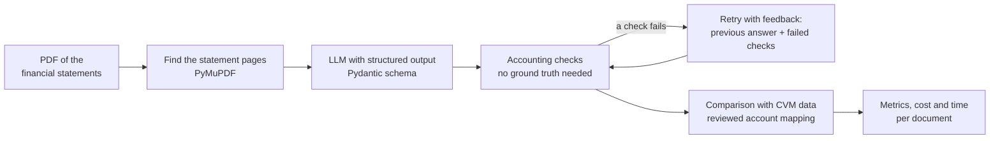
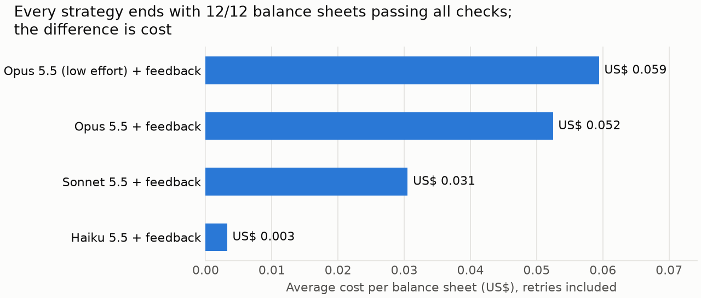
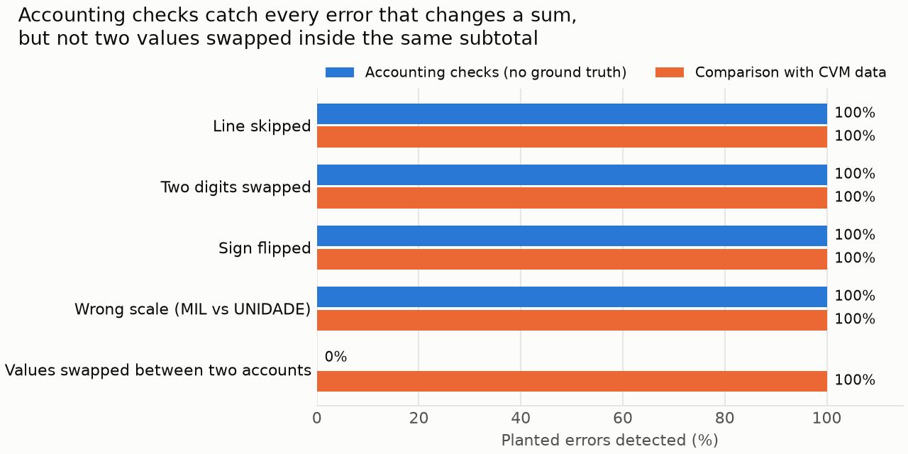

# Financial Statements Extractor

**Extracting Brazilian financial statements from PDFs with LLMs, and measuring how
often the numbers are right** against the official data published by the CVM
(Brazil's securities regulator), with an accountant's eye on where and why it fails.

> **Live demo: [financial-statements-extractorr.streamlit.app](https://financial-statements-extractorr.streamlit.app/)** · Full results tables: [`docs/results.md`](docs/results.md)

---

## The problem

Financial modeling, credit analysis and audit teams still copy balance sheets and
income statements from PDFs by hand. LLMs can read those PDFs, but **"it extracted
something" is not the same as "the numbers are right"**: one swapped digit or a value
read from the wrong column silently breaks a model downstream.

This project treats extraction as a measurement problem:

1. **Extract** the statement from the PDF with an LLM, as structured data validated by
   Pydantic.
2. **Check it like an accountant would**, without any ground truth: do assets equal
   liabilities plus equity? Does every subtotal add up? Are signs and scale coherent?
3. **Compare it with the official CVM data**, line by line, to measure accuracy and
   understand every error.

## How it works



- **Page finder**: locates the balance sheet (BP) and income statement (DRE) pages,
  skipping the table of contents, explanatory notes, earnings-release tables and the
  statement of comprehensive income.
- **Structured output**: the model must answer in the exact schema (account, value,
  subtotal flag, scale, period); values are exact decimals, never floats.
- **Pluggable LLM client**: one interface; Anthropic is implemented, OpenAI and local
  models (Ollama) can be added as new classes.
- **Two independent evaluators**: accounting integrity checks (usable on any PDF) and the
  comparison with the CVM ground truth (for measuring).

## Results

Six listed companies, fiscal year 2025: **WEG** (capital goods), **Klabin** (pulp and
paper), **C&A** (apparel retail) and **Pague Menos** (pharmacy retail) as the main
study, plus **Americanas** and **Assaí** as hard cases. Three Claude models, run through
the Anthropic API. The whole study cost about **US$ 2.60** in API calls.

### Balance sheet: 4 companies x 3 repeats per model

| Model                 | Runs | Accounts found | Values exact | Values within rounding | Runs failing accounting checks | Cost per BP (US$) | Time per BP (s) |
|:----------------------|-----:|:---------------|:-------------|:-----------------------|-------------------------------:|------------------:|----------------:|
| Opus 5.5              |   12 | 100.0%         | 99.2%        | 100.0%                 |                              0 |            0.0525 |              17 |
| Opus 5.5 (low effort) |   12 | 98.9%          | 99.2%        | 100.0%                 |                              3 |            0.0445 |              13 |
| Sonnet 5.5            |   12 | 100.0%         | 99.2%        | 100.0%                 |                              3 |            0.0225 |               8 |
| Haiku 5.5             |   12 | 100.0%         | 99.2%        | 100.0%                 |                              0 |            0.0033 |              25 |

*"Values exact" stops at 99.2% for every model because of two Klabin lines where the CVM
form differs from the PDF by R$ 1 thousand (rounding, see below). Averages over all
mapped accounts of each balance sheet.*

When an accounting check fails, the model gets **one retry with its previous answer and
the list of failed checks**. That fixed **9 out of 9** failing runs (6 balance sheets and
3 income statements), and the CVM comparison confirmed the corrections were real, not
totals forced to match.



### Income statement: key lines, 6 companies

| Model      | Key lines found | Key lines exact | Runs failing checks | ...after feedback | Cost per DRE (US$) |
|:-----------|:----------------|:----------------|--------------------:|------------------:|-------------------:|
| Opus 5.5   | 36/36           | 35/36           |                   0 |                 0 |             0.0302 |
| Sonnet 5.5 | 36/36           | 35/36           |                   0 |                 0 |             0.0135 |
| Haiku 5.5  | 36/36           | 35/36           |                   3 |                 0 |             0.0013 |

The one "miss" is the same for every model and is **not a reading error**: in Klabin's
cost of sales, the CVM form includes the fair-value change of biological assets, which
the PDF shows on a separate line. All three models read the printed value correctly.

### What the accounting checks catch on their own

Synthetic errors planted in correct extractions (83 trials), detected **without** ground
truth vs with the CVM data:



## Key findings

1. **The prompt mattered more than the model.** With the first prompt, Sonnet looked much
   worse (85.8% of accounts found, 32 extra lines). It had read every value correctly but
   placed subtotals *before* their lines. Making the output layout an explicit contract
   (prompt v2) brought all three models to the same accuracy.
   [Details](docs/results.md#prompt-v1-vs-v2-first-repeat).
2. **Errors are systematic, not random.** Every wrong value or misplaced line repeated in
   all 3 runs, on the same company and the same line, so re-running does not help;
   changing the prompt, model or effort does. (The one non-repeating failure was a
   format slip, a dash returned as a value, which a stricter output schema now rules out.)
3. **One layout concentrated the real errors**: Pague Menos prints assets and liabilities
   side by side, so the text interleaves both sides. Sonnet once duplicated a line using
   the prior-year column; Opus at low effort moved a line to the wrong side.
4. **The cheapest model was enough here.** Haiku 5.5 matched Opus 5.5 on every value at
   about 1/16 of the cost. Opus at low effort was a false economy: its retries made it
   more expensive than Opus at the default effort.
5. **The CVM chart of accounts is not the PDF layout.** "Tributos a recuperar" in the PDF
   can be a sub-account in the CVM; treasury shares sit inside profit reserves; biological
   assets move between groups. Matching by name produces false errors, which is why the
   evaluation uses a mapping reviewed by an accountant (below).
6. **The CVM form has its own rounding.** It rounds each account separately, so a PDF
   line that maps to a sum of CVM accounts can differ by R$ 1 thousand.

## Methodology

**Ground truth.** The [CVM open data portal](https://dados.cvm.gov.br) publishes every
annual filing (DFP) as CSV files, one per statement. The loader keeps the latest
restatement (`VERSAO`), the current year (`ORDEM_EXERC = ÚLTIMO`) and converts the scale
(`ESCALA_MOEDA`) to reais. All comparisons use exact decimals.

**Two levels of evaluation.**

- *Key totals*: standardized CVM codes every company reports (total assets, current
  assets, equity; revenue, gross profit, net income). Fully automatic and comparable
  across companies.
- *Line by line*: every account of the PDF, through a **reviewed mapping file** per
  company ([`mappings/`](mappings/)): PDF account → CVM code(s). It supports sums and
  subtractions of codes (`2.03-2.03.09`) and groups of PDF lines that the CVM reports as
  one account. A first draft is generated automatically and then **reviewed by an
  accountant** (the author).

**Values are never used to pair accounts.** The draft uses values only to *suggest*
codes for review. During evaluation, accounts are paired by section and name (or by
position, for subtotals the PDF prints without a label). Otherwise a wrong value could
never show up as an error.

**Rounding tolerance.** `Values exact` is the headline metric. `Values within rounding`
accepts a difference of one unit of the statement's scale (e.g. R$ 1 thousand), which
separates the CVM's rounding from reading errors. Its blind spot: an error in the very
last digit.

**Accounting integrity checks** (no ground truth): assets = liabilities + equity; every
subtotal equals the lines it aggregates (found with a stack, so no hierarchy is needed);
the declared scale matches the PDF header; key lines have the expected sign (revenue > 0,
cost < 0, asset totals > 0).

## Example

Input (text extracted from WEG's balance sheet page; each table cell on its own line):

```text
Tributos a recuperar
8
-
-
762.068
 685.536
  Imposto de renda/contribuição
    social a recuperar
23.365
14.710
221.894
131.878
```

Output (consolidated column, current year), plus run metadata:

```json
{
  "run": {"model": "claude-opus-5-5", "input_tokens": 5265, "output_tokens": 1522,
          "seconds": 17.1, "cost_usd": "0.0515"},
  "statement": {
    "company": "WEG S.A.", "statement_type": "balance_sheet", "scope": "consolidated",
    "reference_date": "2025-12-31", "currency_scale": "MIL",
    "lines": [
      {"account_name": "Tributos a recuperar", "value": "762068", "is_total": false},
      {"account_name": "Imposto de renda/contribuição social a recuperar", "value": "221894", "is_total": false},
      {"account_name": "Dividendos e juros sobre capital próprio a receber", "value": "0", "is_total": false},
      {"account_name": "Outros ativos circulantes", "value": "873801", "is_total": false},
      {"account_name": "Ativo Circulante", "value": "26910845", "is_total": true}
    ]
  }
}
```

## Known limitations

- **A wrong source document goes unnoticed by the checks.** Assaí's PDF bundles an
  earnings release before the statements; an extraction from the release page passed
  every accounting check. The page finder now skips release pages, but no internal check
  can tell that the document itself is the wrong one.
- **Compensating errors** (two values swapped inside the same subtotal) pass all
  accounting checks; only an external source catches them.
- **Small sample**: 6 companies, one fiscal year, balance sheet and income statement only
  (no cash flow statement yet). The income statement is evaluated on key lines only.
- **Name lists come from these PDFs**: the aliases used to find key income-statement lines
  were taken from the six documents studied and will need extending for other companies.
- **Synthetic errors are clean**: real model errors can be messier (duplicated lines,
  prior-year values, wrong column), as the experiments showed.
- **Text-based PDFs only**: scanned documents would need OCR first.

## Project structure

```
src/
  extraction/      PDF -> pages -> LLM -> validated statement (no evaluation code)
    pdf_reader.py    page finder
    schemas.py       Pydantic models (statement, line, scale)
    llm_client.py    single interface over LLM providers
    extractor.py     prompt versions and orchestration
  evaluation/      everything that judges an extraction
    cvm_loader.py    loads and normalizes CVM data (ground truth)
    matching.py      key totals, mapping drafts, line pairing
    metrics.py       coverage, exact match, within rounding
    integrity.py     accounting checks (no ground truth)
    error_injection.py  planted-error experiment
    evaluate.py      command-line evaluation
  experiments/     combines both sides
    run_experiment.py   model x prompt x effort x company x repeat
    feedback.py         retry failed runs with the failed checks
    tables.py           results tables (README and app)
    report.py           builds docs/results.md and the figures
    build_samples.py    builds the small data sample used by the app
mappings/          reviewed PDF -> CVM account mappings
results/           one CSV per experiment (versioned)
docs/              results tables and figures
data/samples/      versioned sample for the app (extractions, CVM rows, page images)
app/               Streamlit app
tests/             pytest suite (no API calls)
```

## How to run

Requirements: Python 3.12+ and [uv](https://docs.astral.sh/uv/).

```bash
uv sync                              # install dependencies
cp .env.example .env                 # then fill in ANTHROPIC_API_KEY
uv run pytest                        # tests never call the API
```

Data (not versioned): put the statement PDFs in `data/raw/` as `<TICKER>_DFP_2025.pdf`
and the CVM annual file `dfp_cia_aberta_2025.zip` (≈13 MB, from
[dados.cvm.gov.br](https://dados.cvm.gov.br/dataset/cia_aberta-doc-dfp)) in
`data/raw/cvm/`.

```bash
# extract one statement
uv run python -m src.extraction.extractor data/raw/WEG_DFP_2025.pdf --statement balance_sheet

# evaluate it (key totals, line by line, accounting checks)
uv run python -m src.evaluation.evaluate data/processed/WEG_DFP_2025_balance_sheet_consolidated.json --details

# run an experiment (runs that already exist are skipped, so nothing is paid twice)
uv run python -m src.experiments.run_experiment --name models --models claude-haiku-5-5 --repeats 3

# rebuild the results tables and figures
uv run --group report python -m src.experiments.report
```

The Streamlit app runs on the small versioned sample in `data/samples/`, so it needs
neither the PDFs nor an API key:

```bash
uv run --group app streamlit run app/streamlit_app.py

# after new runs: rebuild the sample and the app's requirements file
uv run python -m src.experiments.build_samples
uv export --format requirements-txt --no-hashes --no-dev --group app --no-emit-project -o app/requirements.txt
```

## Data and license

All data is public: companies' own financial statements and the CVM open data portal.
No client or private data is used. Code under the [MIT License](LICENSE).
